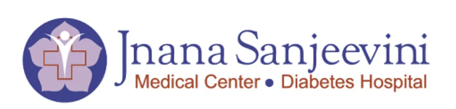
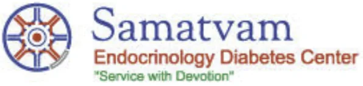

**Samatvam Endocrinology Diabetes** is a group of institutions that specialize in treating and managing diabetes and other endocrine metabolic disorders. The central goal is to provide health care of highest possible quality to the highest possible quantity - to foster humane, honest and holistic health care. The foundation is the harmonious integration of science and spirituality in the context of health care.

Founded in 1987, **Samatvam** (= equanimity) has four core areas: health care, education, research and social welfare.

Currently, we serve through the following health care – medical facilities:

## Samatvam Endocrinology Diabetes Centers

-   313, 33 Cross, 17th Main, Jayanagar 4th T Block, Bangalore 560 041. India. Phone: 4111 3308, 2663 7486. 24 Hour Helpline: 9448356575. Email: [samatvam@gmail.com](mailto:samatvam@gmail.com)
-   640, I Main, I Stage, Indiranagar, Bangalore 560 038, India. Phone: 91 80 - 25213156, 25257508 24 Hour Helpline: 9449994978. Email: [sharda.a@gmail.com](mailto:sharda.a@gmail.com)
-   82, 36th Main 4th A cross BTM 1st Stage, 1st Phase, Dollar's Scheme, Bangalore - 560068.India. Phone: 7022635742. 24 Hour Helpline: 7022635742. Email: [samatvambtm@gmail.com](mailto:samatvambtm@gmail.com)

**Jnana Sanjeevini** (= knowledge for health and life) is a dedicated community health care project of **Samatvam Trust**, initiated in 2003, in JP Nagar, Bangalore.  Its aim is to provide multidisciplinary care for diabetes and related health problems “all under one roof”, irrespective of the socioeconomic status of the beneficiaries. **Jnana Sanjeevini** is a total health project, which hopes to scientifically combine and integrate both the physical and spiritual dimensions of health, towards human and societal good.

## Jnana Sanjeevini Medical Center and Diabetes Hospitals

-   2, 1 A Cross Marenahalli, JP Nagar Phase 2; Bangalore 560078, India; Phone: 91 - 80 - 26493040, 26493060; 24 Hour Helpline: 9448350728; Email: [jsmcindia@gmail.com](mailto:jsmcindia@gmail.com)

## Medical Directors: Senior Consultants Endocrinology Diabetes

-   Dr. S Srikanta. MD (AIIMS), (PhD), FACE (Duke University Medical Center, Joslin Diabetes Center, Harvard Medical School, USA). Email: [samatvam@gmail.com](mailto:samatvam@gmail.com)
-   Dr. A Sharda. MD, DNB, MRCP, FACE, FRCP (University California, Henry Ford Hospital, USA; McGill University, Canada; Email: [sharda.a@gmail.com](mailto:sharda.a@gmail.com)
-   Dr. Tejaswini Patil. MD, FEDM, FACE (University Liverpool, Birmingham Heartlands Hospital, Royal Albert Infirmary, UK). Email: [samatvambtm@gmail.com](mailto:samatvambtm@gmail.com)

## Diabetes

-   Day Care Unit
-   Heart - Kidneys - Eyes - Feet
-   Annual Health Review
-   Family Education Unit

## Endocrinology

-   Hormone Laboratory
-   Infertility - Reproduction
-   Thyroid - Obesity - Lipids
-   Growth – Development

## Diagnostics

-   Laboratory
-   ECG
-   X-ray
-   Ultrasound
-   TMT
-   ECHO
-   PFT
-   Dispensary

## Specialties / Referrals

-   Family Medicine
-   Diabetes Endocrinology
-   Ophthalmology
-   Nephrology
-   Cardiology
-   Pulmonary Medicine
-   Surgery
-   Obstetrics Gynecology
-   Pediatrics
-   Orthopedics
-   Rheumatology
-   Urology
-   Dermatology
-   Dentistry
-   Psychiatry
-   ENT
-   Foot Care
-   Spiritual Medicine

## Uniqueness

What Samatvam aspires to submit to people and society in the years, decades and centuries ahead is:

-   utmost honesty
-   respect and dignity to the suffering people
-   highly merited and devoted students and staff
-   health care of highest possible quality to the highest possible quantity: “a temple(s) for healing and learning”, combining:
    -   the best of east and west
    -   the principles of science and religion

## Inspiration

-   “There are diseases of the body, and diseases (ignorance) of the Soul. So keep learning, working and serving.” - Dr Paul Ehrlich
-   “From untruth to Truth, from darkness to Light, and from death to Immortality, deliver me.” - Brhadaranyaka Upanishad
-   "Science without religion is lame; Religion without science is blind." - Dr Albert Einstein
-   "Science can only prolong life; Religion deepens it." - Dr Yellapragada Subba Row
-   "Let every action of mine, be something beautiful for God." - Mother Teresa
-   “Be and make.” - Swami Vivekananda

## Services

Samatvam serves children and adults with diabetes and other endocrine metabolic disorders from the city of Bangalore, various other parts of Karnataka, neighboring states, and even other parts of India. Referred overseas patients also seek Samatvam’s patient care services through annual visits and online consultations. Comprehensive and continuing care (including primary care for desiring patients) and annual health reviews are provided under one roof, with further specialty referrals to eminent doctors and medical centers of Bangalore, as per need. A large number of people with type 1 and type 2 diabetes are treated at our centers. Treatment is both for those with newly diagnosed diabetes as well as for those with late complications. For in-patient hospital and emergency care, we work together with several leading secondary and tertiary care hospitals of Bangalore, where Samatvam doctors and teams serve as Senior Consultants. Fully integrated electronic patient medical records have been used in the clinic since 2003. The goal is to serve not only the patient, but the entire family, covering all socioeconomic segments of our society.

## History

**Samatvam: Science and Research for Human Welfare Trust** is a registered non-profit charitable public trust, envisioned and initiated by a group of medical volunteers in 1987.  [Samatvam = Equanimity; “Samatvam Yoga Uchyate” = Equanimity is Yoga; Bhagavad Gita, 2nd chapter].   Its philosophy is “to try to provide and achieve the best of east and west”, towards honest, humane and holistic health care of highest possible quality to the highest possible quantity. Samatvam was established to provide comprehensive health care for people with diabetes and other endocrine metabolic disorders, with care and compassion (Service with Devotion).   Since its inception, a major focus of Samatvam’s public service activities has been providing treatment to the poor and needy from different parts of Karnataka State, neighboring states, and other parts of India. Jnana Sanjeevini (= Knowledge for health and life) is a dedicated community health care project of Samatvam Trust, initiated in 2003, in JP Nagar, Bangalore.  Its aim is to provide multidisciplinary care for diabetes and related health problems “all under one roof”, irrespective of the socioeconomic status of the beneficiaries [Project DISHA and Project DOSTI].

The special strengths of **Samatvam** include merited faculty and staff, ongoing international collaborations and enrichment, and most importantly, sincerity and dedication in public service and human good **[“Service with devotion”]**.

## Logo

The founding philosophy of Samatvam (= equanimity, Samatvam Yoga Uchyate, sanskrit for Equanimity is Yoga, Bhagavad Gita, 2nd chapter) is **harmonious integration of science and spirituality in the context of health care**.  Thus, in 1986, its initial logo was a simple “circle with a horizontal diameter”, representing the 2 balanced facets, science and spirituality. In 1990, the logo received an artistic and scientific rendition (Ms Wasima Kausar, Dr Pankaj Shah), when it became a “Konark wheel inside a recombinant DNA bacterial plasmid”, once again reflecting the fusion of spirituality and science.  In 1994, the Konark wheel was “humanized” (Mr KR Bilimoria), with the 8 spokes of the wheel being artistically simplified and transformed into 8 human beings holding hands (4 persons in blue representing the patients and 4 persons in red representing the medical team), with all their heads (and hearts) in unison at the central hub. [Current logo: “humanized Konark wheel inside a recombinant DNA bacterial plasmid]. This evolution emphasizes the importance of the close networking, friendship and compassionate commitment between the health care recipients and providers, all with full faith in God **(We Plan, He Steers;  We Pray, He Wills; We Care, He Heals.)**
