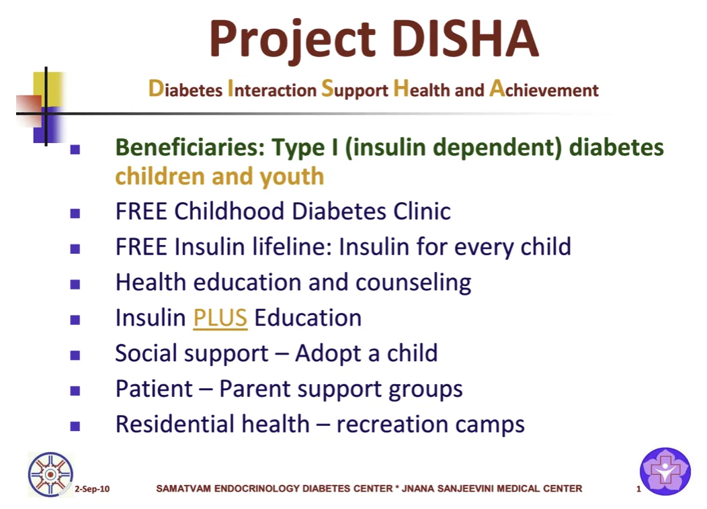
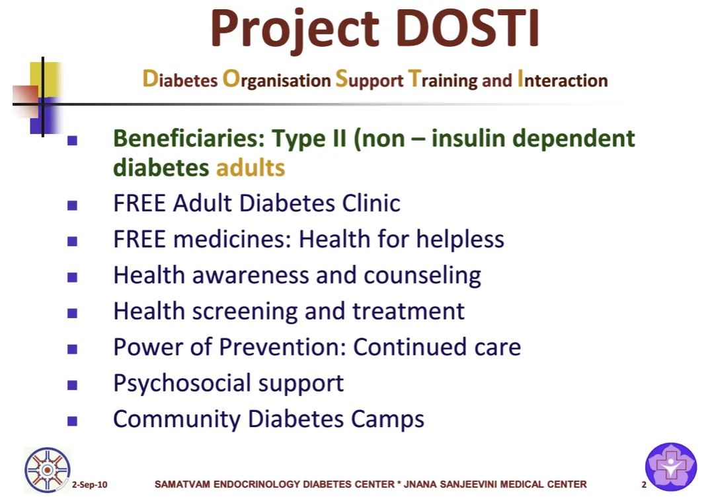
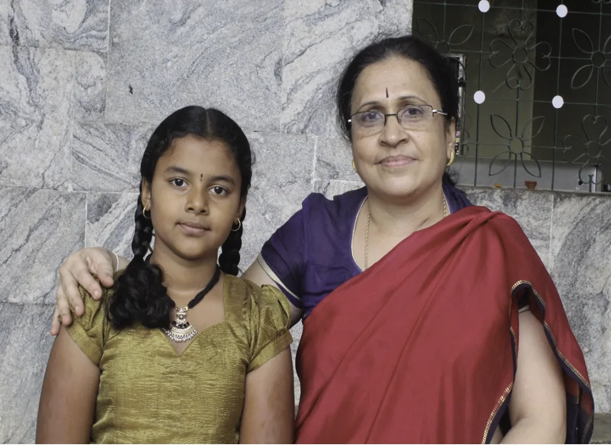
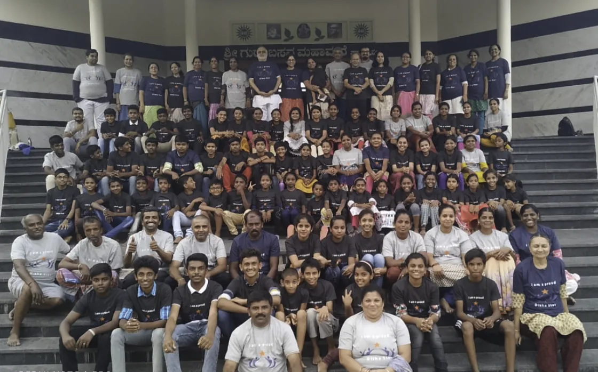
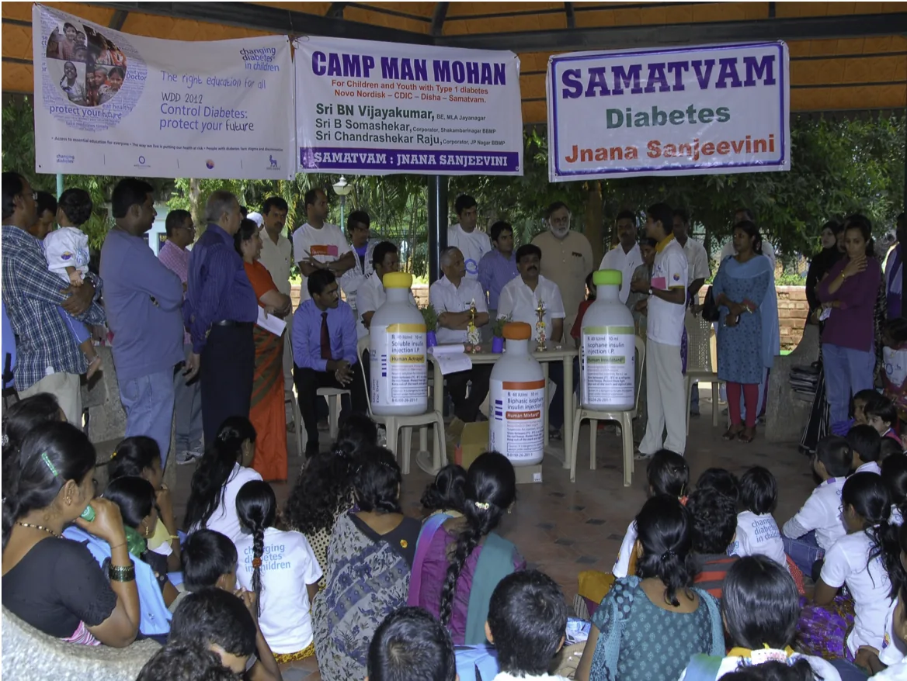
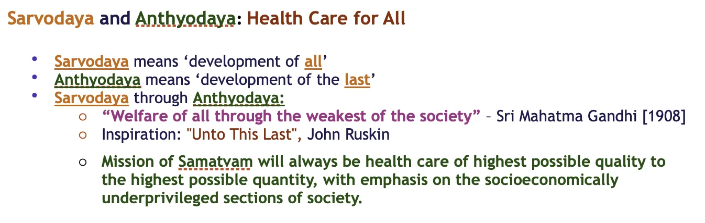

**“No one will leave Jnana Sanjeevini uncared and unprovided, irrespective of their socioeconomic status.”** This was the premise for the inception of Samatvam in 1987. Till today, with the philanthropy and magnanimity of few Good Samaritans [individuals and institutions], and the “Service with Devotion” of our volunteers, our institution has been able to keep up with this promise, in its own little way.

Through the charity Projects DISHA and DOSTI, more than 3000 children with Type 1 diabetes, and 30,000 adults with type 2 diabetes, thus far, have been the beneficiaries of FREE medical care and counseling, medicines, diagnostic services, education – employment and other forms of social support etc. Besides the above FREE services, social engineering and cost cross subsidy, have helped us to reach out a much larger segment of our society at the bottom of the socioeconomic pyramid.

### DISHA DOSTI

Samatvam Free Diabetes Clinic for the Poor

**DISHA:** Providing FREE life saving insulin, comprehensive medical care and social support for all poor and needy type 1 (insulin dependent) diabetes children in the community, to ensure the basic survival and optimum health of these unfortunate children, afflicted by a life long killer disease (but well manageable with proper medical and social support).

**DOSTI:** Providing FREE life saving diabetes, blood pressure, lipids and related medicines and comprehensive medical care and social support for all poor and needy type 2 (non-insulin dependent) diabetes adults in the community, to ensure the basic survival and optimum health of these unfortunate people, afflicted by a lifelong, debilitating killer disease (but well manageable with proper medical and social support).

**Cost of “Basic / Minimum” Type 1 Diabetes Care per child per year in India (approx.) Out Patient\*\***

| Item | Cost Rupees | Notes |
| --- | --- | --- |
| Insulin | 6000 | Human insulin @ 40 units per day |
| Insulin Syringes | 1500 | Average 200 Syringes per year |
| Diagnostic Tests | 2500 | HbA1C, S Creatinine, Urine Microalbumin, CBC, TSH, Eye- Fundus |
| Transportation | 2000 | 1 Specialist, 6 general doctors’ visits |
| **Total** | **20000** |  |

**Cost of “Basic / Minimum” Type 2 Diabetes Care per adult per year in India (approx.) Out patient\*\***

| Item | Cost Rupees | Notes |
| --- | --- | --- |
| Medicines | 6000 | Diabetes, blood pressure, lipids and related medicines |
| Diagnostic Tests | 3000 | HbA1C, S Creatinine, Urine Microalbumin, CBC, Eye- Fundus, Radiology, Cardiology etc |
| Transportation | 1000 | 1 Specialist, 3 general doctors’ visits |
| **Total** | **10000** |  |

**\*\* In the event of need for hospitalisation the expense could well exceed Rs 16000 per hospitalisation (Median cost**

**Donations** of any kind (material and might) are welcome and gratefully acknowledged (including naming your sponsorship / facility). Donations made to **"SAMATVAM :Science and Research for Human Welfare Trust”** qualify for exemption under the section 80G of the Income Tax Act – Govt of India. [**Trustees - Contact persons**: Ms Padmaja Srinivas, 91-9845445660; [psrinivasdiabetes@gmail.com](mailto:psrinivasdiabetes@gmail.com); Dr Bhanudev Bhatt, 91-9448391060, [bbhatt.samatvam@gmail.com](mailto:bbhatt.samatvam@gmail.com); Mr Harsha Ananthaswamy, 91-9986304719, [aharshadiabetes@gmail.com](mailto:aharshadiabetes@gmail.com)].  C /O: Jnana Sanjeevini; 2, 1st A Cross, Marenahalli, J P Nagar, Phase 2, Bangalore 560078, India.

**Respects and Pranams**

**Patrons - Trustees - Staff - Volunteers - Team Samatvam**

**Donations through Cheque / Drafts:**

| In Favour of | Samatvam Science and Research for Human Welfare Trust |
| --- | --- |
| Payable at | Bangalore, India |

**Donations through Online Transfer’s via NEFT/RTGS, bank details are as below:**

| Name | Samatvam Science and Research for Human Welfare Trust. |
| --- | --- |
| Account Number | 034601000010752 |
| Bank/Branch | Indian Overseas Bank, Jayanagar 5th Block Branch, Bangalore, India |
| IFSC | IOBA000034 |

**All Foreign/International  Donations to made to designated FCRA Bank account only as below:**

| Name | Samatvam Science and Research for Human Welfare Trust. |
| --- | --- |
| Account Number | O67701000016848 |
| Bank/Branch | Indian Overseas Bank/ East End Main Road Branch.42/166, East End Main Road,  9th  Block, Jayanagar, Bangalore -560069, Karnataka, India. |
| IFSC | IOBAINBB011 |

-   Approval U/s 80G from Director of Income Tax (Exemptions) – No: DIT(E/80G/(R/3/AAATS5649B/ ITO(E)-3/2012-13, Dated: 09/04/2012. Trust PAN: AAATS5649B.
-   Registration Under Foreign Contribution (Regulation) Act (FCRA); Registration Number: 094421055

