-   **Project DEEPA** is directed towards Diabetes physicians, counselors and other health professionals. This fosters the much needed Diabetes Health Care Manpower Development and Capacity Building, through local, national and international Scholarships - Observerships - Internships and Fellowships, and Continuing Medical Education and training.
    
    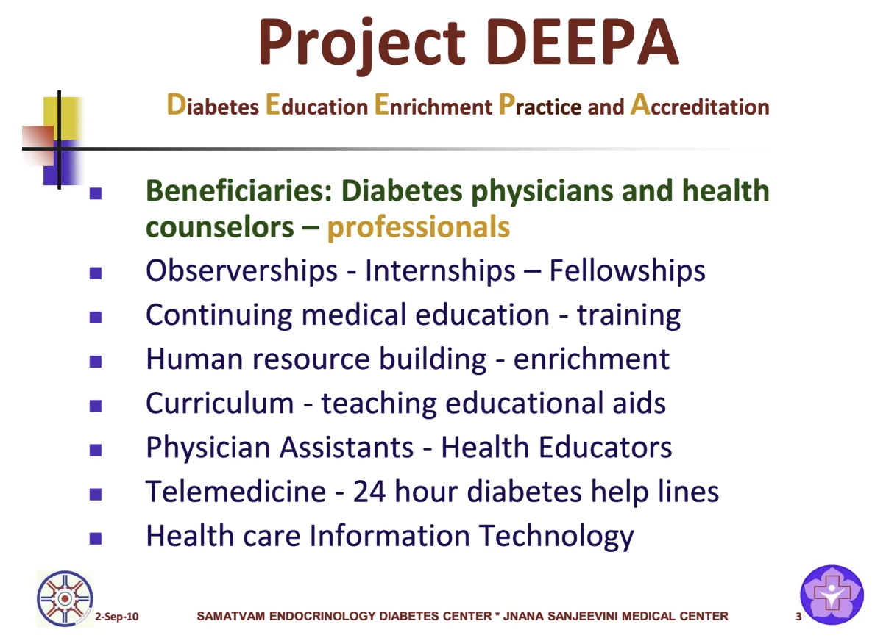
    
-   **Igniting the Minds – Samatvam Alumni:** Samatvam Alumni: ie. Medical and other students, physician residents, fellows and consultants, nurses, counselors, social workers and scientists, all inspired, trained and nurtured by Samatvam – Jnana Sanjeevini, are currently serving people and communities across the world, in various specialties and capacities.
-   **Torch of Life – Diabetes health care manpower capacity building :** In collaboration with Public Health Foundation of India, Samatvam has trained the record highest number [for the country] of primary care and specialist doctors, to deliver higher standards of diabetes care for the people and families served by them. The philosophy of Service with devotion, scientific spirit and passionate and compassionate medical care have been intensively infused.

## Education: Medical Education – Jnana Sanjeevini

-   In House Medical Education Programs
-   Seminars and Workshops
-   Local, National and International CMEs
-   National and International Observerships
-   Awards

## Medical Education – Jnana Sanjeevini

-   **Clinic Table Rounds:**

-   Every Day – Every Patient

-   **Sanjeevini Jnana Yagna:**

-   Every Tuesday – 6 hours

-   **Teleeducation - Webinars:**

-   Sundays, Tuesdays

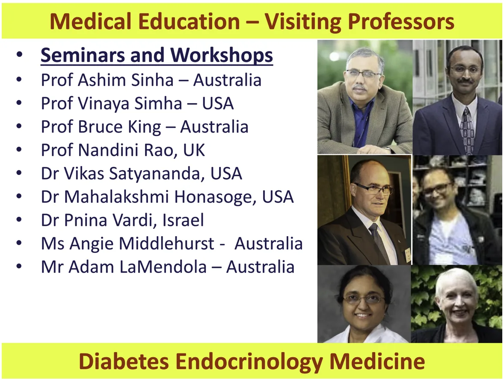

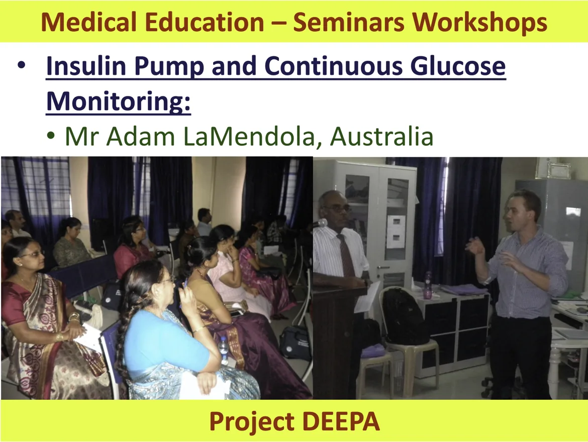

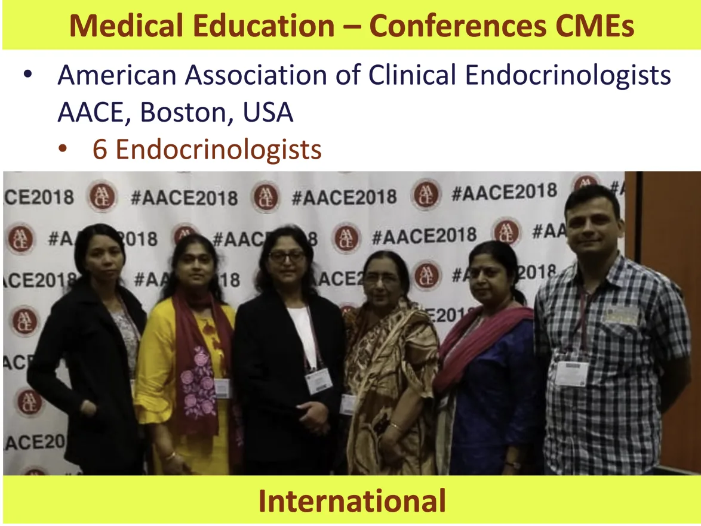

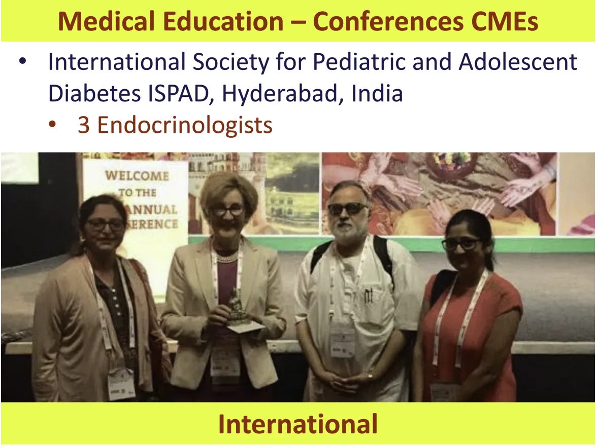

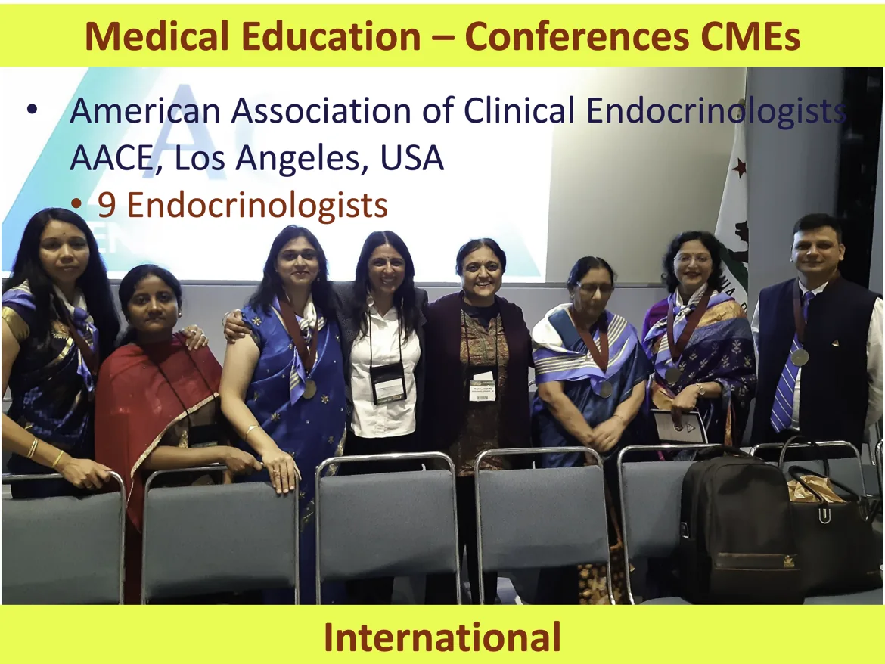

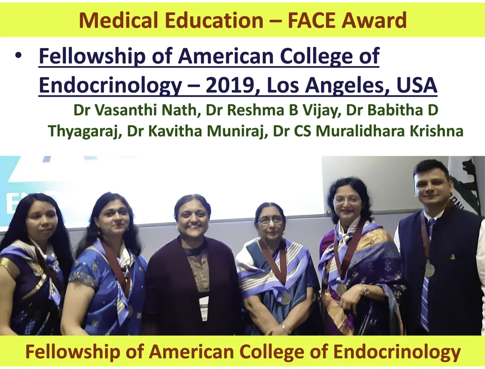

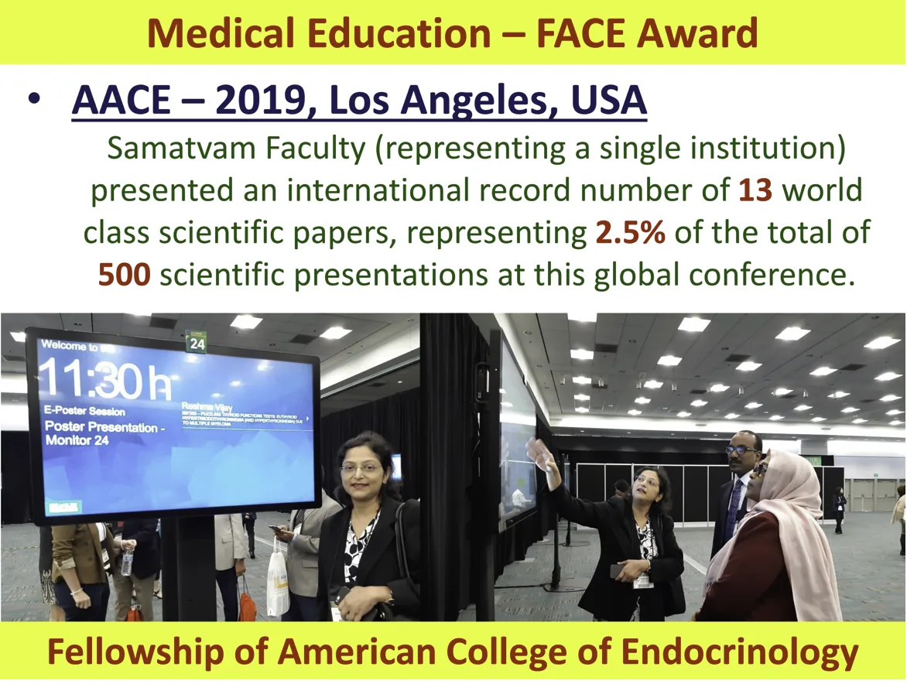

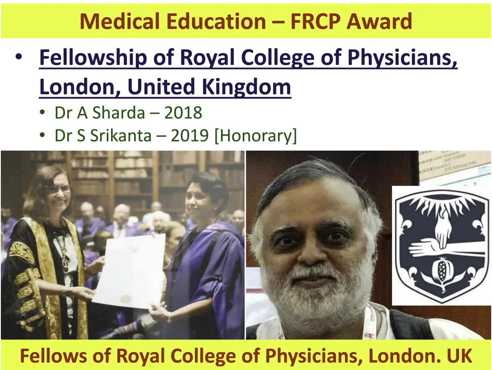

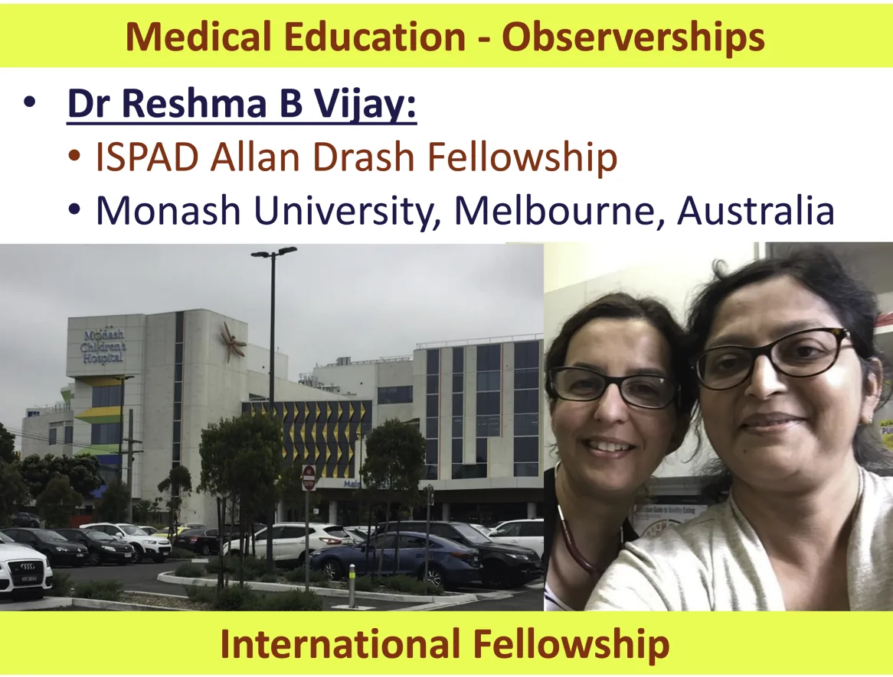

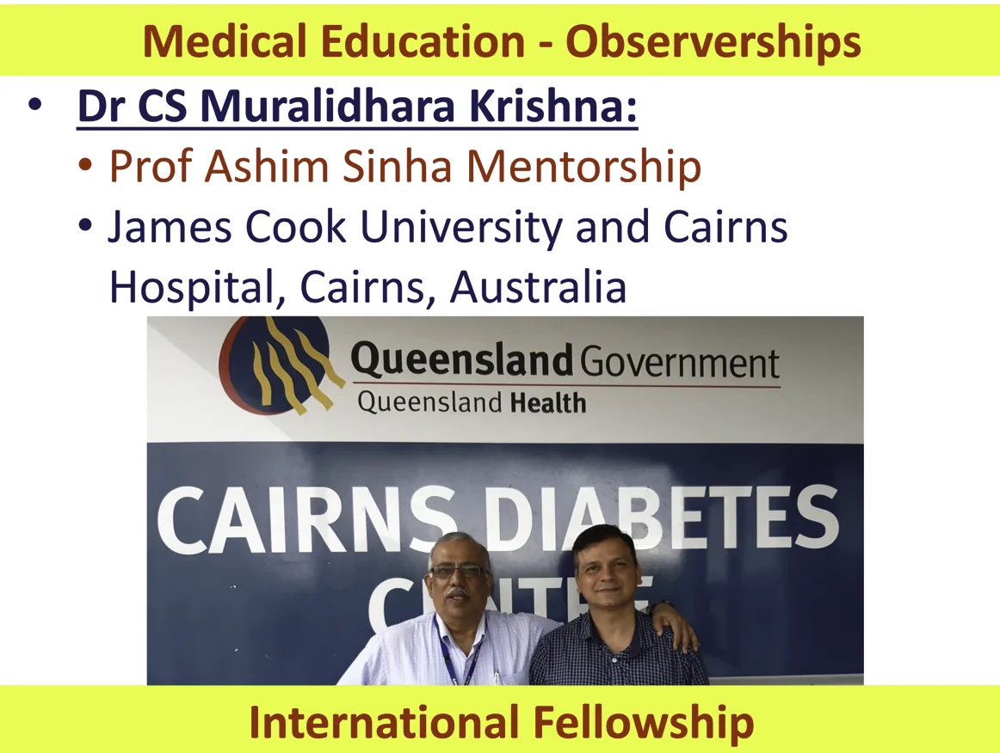

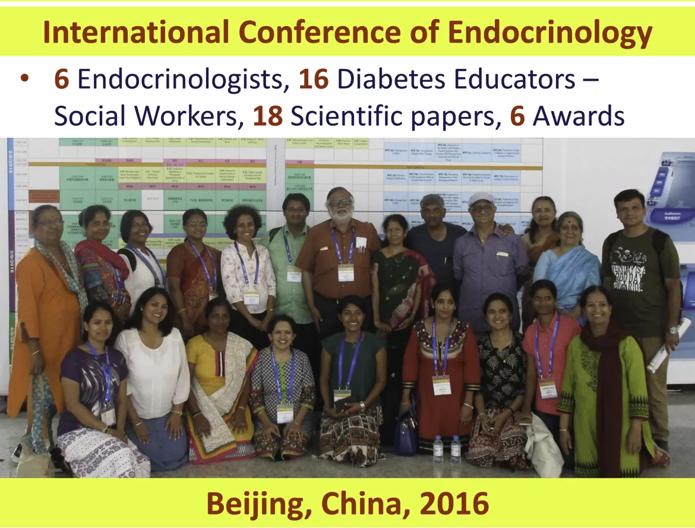

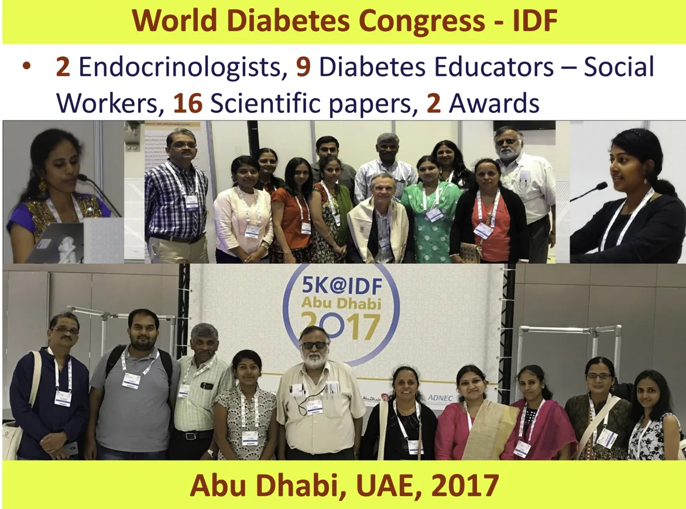
