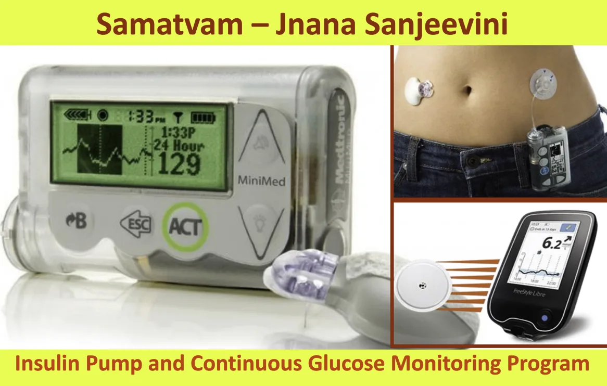
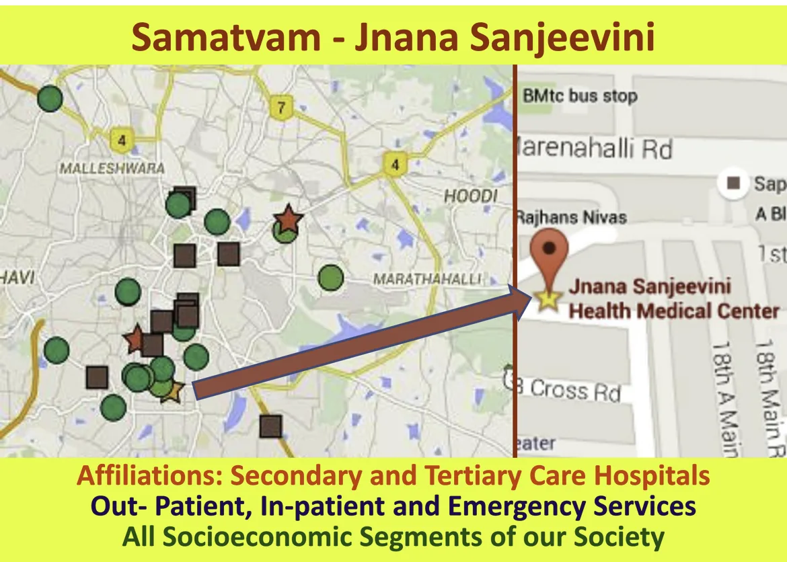
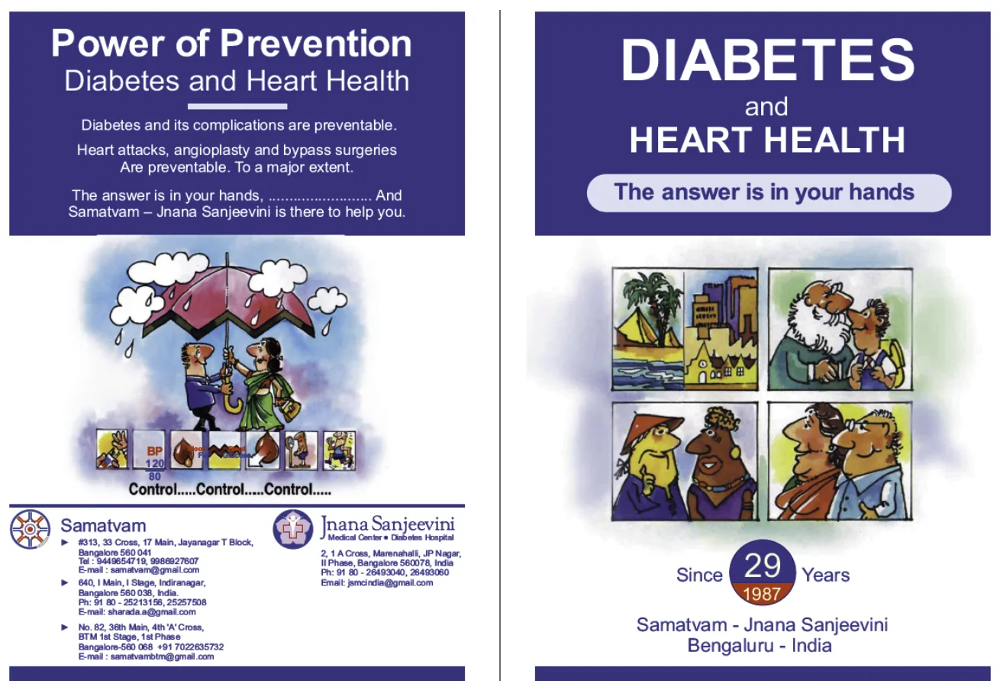

-   Out Patient – Day Care Services
-   In Patient Services
-   Patient Education Programs
-   Laboratory and Diagnostics Services
-   Telemedicine Services

### Out Patient – Day Care Services: 2018 - 2019

## Out Patients – Day Care, Jnana Sanjeevini, JP Nagar

-   Endocrinology Diabetes > 10000
-   Ophthalmology > 650
-   Podiatry Foot Care > 200
-   Psychiatry > 300
-   General Medicine
-   General Surgery

## Out Patients – Day Care, Samatvam Endocrinology Diabetes Centers

-   Samatvam Jayanagar > 3000
-   Samatvam Indiranagar > 6000
-   Samatvam BTM 1 > 800
-   Samatvam BTM 2 > 1800

## Speciality Diabetes Clinics

-   Paediatric Diabetes
-   Pregnancy Diabetes
-   Healthy Heart
-   Insulin Perfection

-   Continuous Glucose Monitoring > 400
-   Insulin Pumps > 100

## Speciality Endocrinology Clinics

-   Thyroid
-   Obesity
-   Bone Health
-   Paediatric Endo
-   Reproductive Endo
-   Pituitary Adrenal

## Out Patients - Day Care: Affiliated Hosp

-   NIMHANS > 1000
-   Sri Krishna Sevashrama > 2000
-   Rangadore > 1000
-   Sagar > 400
-   Vikram > 6000
-   Sparsh > 2000
-   Chinmaya Mission > 2400
-   Cloud Nine > 1400
-   Apollo > 2400

### In Patient – Emergency Services: 2018 - 2019

## In Patients Emergency: Affiliated Hospitals

-   Shanthi > 100
-   Sagar > 100
-   Vikram > 4000
-   Sparsh > 600
-   NIMHANS > 400
-   Apollo > 480
-   Excel Care > 20

Samatvam Patients, Cross Referrals, Intensive Critical Care, Post - Operative Care, Multidisciplinary Care

### Health Education - Counselling

## Counselling - Self Care

-   Individual
-   Family
-   Group

-   To be rekindled

-   General Public

-   Camps, Seminars

-   Mass Media

-   Print, Electronic

## Patient Education Resources

-   Diabetes Teaching Guides

-   Kannada, English, Hindi

-   Heart Health
-   Thyroid
-   Bone Health

-   Osteoporosis

-   Others

-   Renal Diet, GERD, etc

## Diagnostic Services

**Laboratory**

-   In House: Limited – Point of Care Testing
-   [Rest Speciality Referral Labs]
-   Clinical Chemistry > 3000
-   Hormone Endocrinology > 3000
-   Haematology > 3000
-   Immunology > 1000

**Cardiology**

-   ECGs > 4000
-   ABPM (Ambulatory BP monitoring ) > 20
-   ECHO > 150
-   TMT

**Radiology**

-   X ray
-   Ultrasound > 300

**Pulmonary**

-   Home Sleep Study > 30

## Telemedicine – Telecounselling Services

**World’s largest 24 x 7 helplines: Since 1994 FREE**

-   Telephone, Whats app, Emails etc
-   2018 – 2019 > 50000 encounters
-   Doctors
-   Counsellors
-   Karnataka State, Out of State and International calls

-   Emergency Diabetes Care, Emergency Hospital Admissions; General Queries
